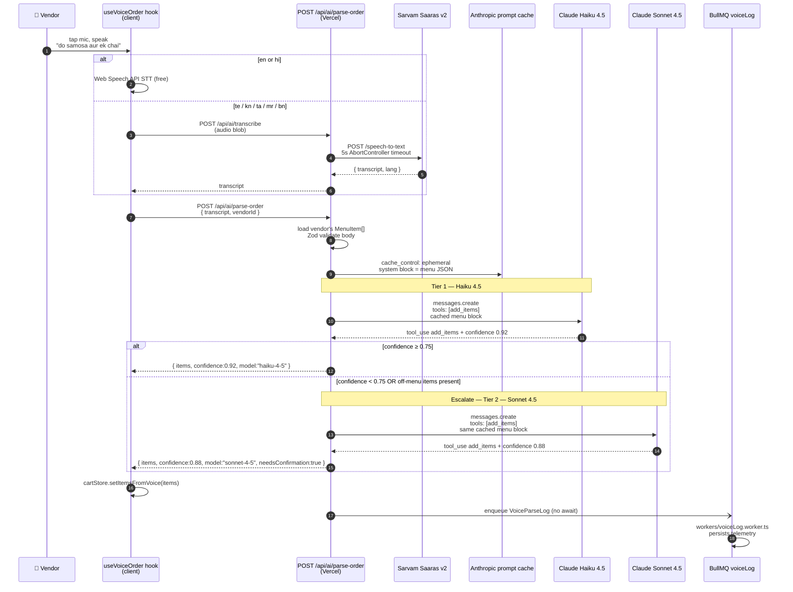
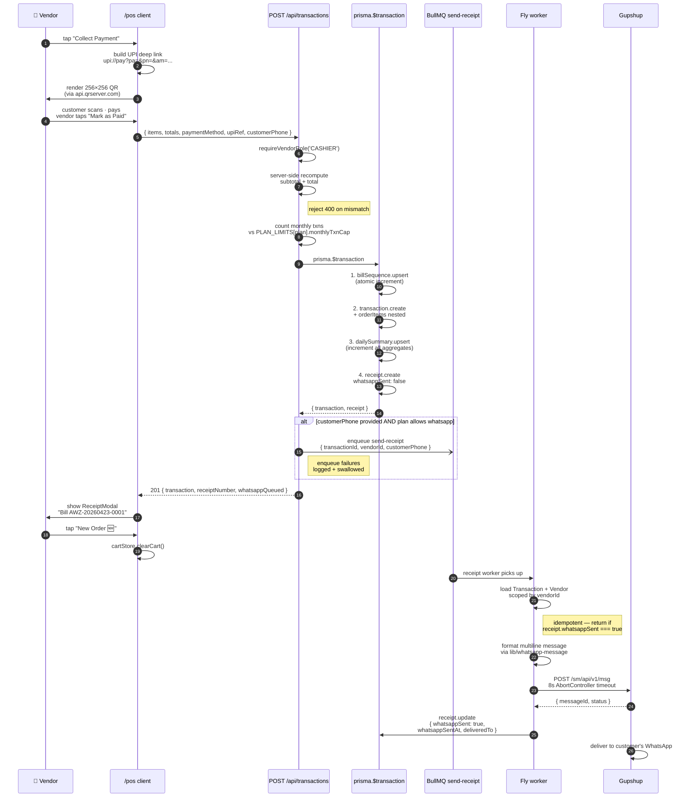
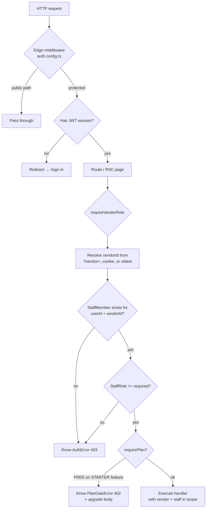
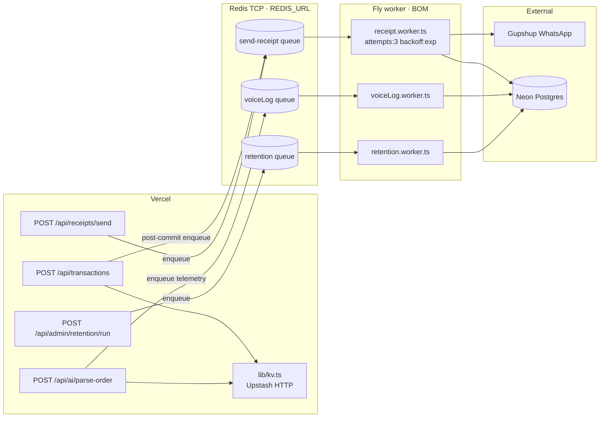
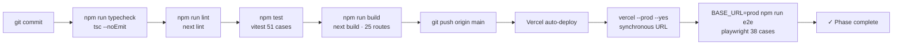
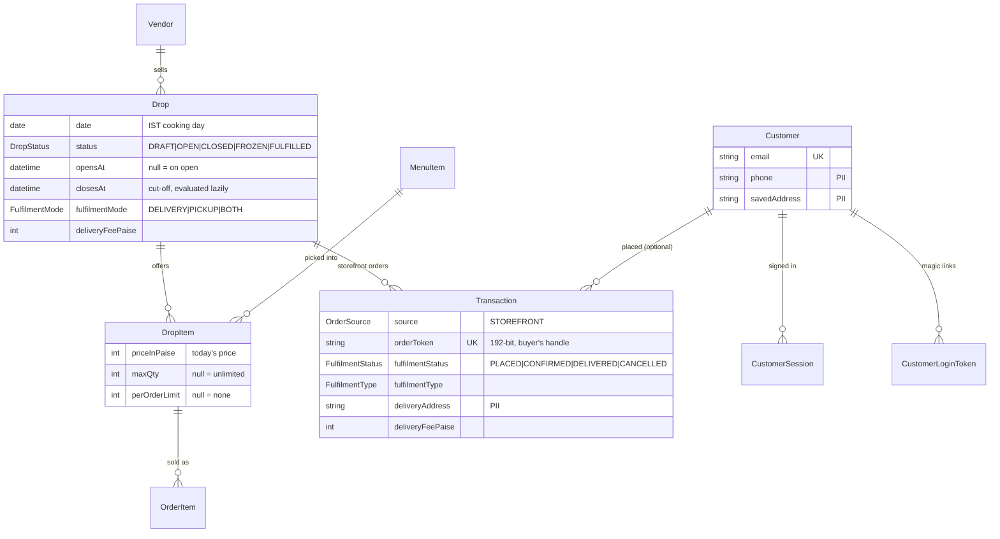
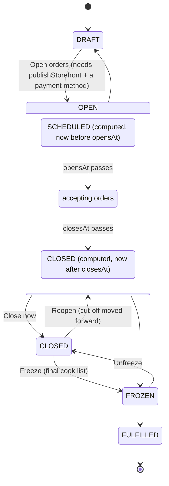

# AwaazOS — Architecture

A working blueprint of the system as it ships today. Read this top-to-bottom before changing the data model, the AI pipeline, or the deploy topology.

---

## 1. System topology

Three providers, one user-facing alias.

```mermaid
flowchart LR
    subgraph User
        Vendor[👤 Vendor on phone<br/>Chrome / WebView<br/>en-IN, IST]
        Customer[👤 Customer<br/>UPI app · WhatsApp]
    end

    subgraph Vercel[Vercel · Edge + Serverless]
        Edge[Edge Middleware<br/>Auth.js v5 · session check]
        Pages[Next.js RSC pages<br/>/marketing /vendor]
        APIs[/api/* route handlers<br/>Node runtime]
        KvHttp[(Upstash REST<br/>UPSTASH_REDIS_*<br/>rate limit · idempotency)]
    end

    subgraph Fly[Fly.io · BOM region]
        Workers[BullMQ Workers<br/>voiceLog · send-receipt · retention<br/>Node 20 alpine · 512MB]
        Redis[(Redis TCP<br/>REDIS_URL<br/>BullMQ queues)]
    end

    subgraph Neon[Neon Serverless Postgres]
        Pool[(Pgbouncer pooled<br/>DATABASE_URL)]
        Direct[(Direct conn<br/>DIRECT_URL · migrations)]
    end

    subgraph External[External APIs]
        Anthropic[Anthropic<br/>Claude Haiku 4.5 + Sonnet 4.5]
        Sarvam[Sarvam Saaras v2<br/>Indic STT]
        Razorpay[Razorpay<br/>Subscriptions + Webhooks]
        Gupshup[Gupshup<br/>WhatsApp Business API]
    end

    Vendor -->|HTTPS| Edge
    Edge --> Pages
    Edge --> APIs
    Pages --> Pool
    APIs --> Pool
    APIs -->|HTTP| KvHttp
    APIs -->|enqueue TCP| Redis
    APIs -->|tool-use| Anthropic
    APIs -->|audio blob| Sarvam
    APIs -->|create sub| Razorpay
    Razorpay -->|webhook · HMAC| APIs
    Workers --> Redis
    Workers --> Pool
    Workers -->|HTTPS| Anthropic
    Workers -->|HTTPS| Gupshup
    Gupshup -->|WhatsApp message| Customer
    Customer -->|UPI scan| Vendor
```

### Why this split

- **Vercel** handles the user-facing surface — Next.js RSC, edge middleware (10ms cold start), serverless API routes for short-lived work
- **Fly.io BOM** handles long-running BullMQ workers (Vercel functions are a poor fit for long-lived TCP + retry-heavy job consumers)
- **Neon** is serverless Postgres — branchable per-PR previews, scales to zero, single-region today (us-east-1) to keep latency low for Vercel's serverless hop
- **Two Redis surfaces:** **`UPSTASH_REDIS_REST_URL` + `UPSTASH_REDIS_REST_TOKEN`** power `@upstash/redis` on Vercel (sliding-window rate limits, idempotency keys, monthly AI caps, `/api/ready` Redis probe). **`REDIS_URL`** (`rediss://` TCP) is for **BullMQ only** on Fly (and optionally on Vercel if you point at a **public** endpoint — never a Fly `*.internal` hostname).

### Latency budget (typical voice-to-bill flow)

| Step | Median | P95 |
| --- | ---: | ---: |
| Browser → Vercel `/api/ai/transcribe` | 80ms | 200ms |
| Sarvam STT (5s audio) | 1.2s | 2.5s |
| Vercel → Anthropic Claude Haiku 4.5 | 350ms | 800ms |
| Cart UI update | 16ms | 32ms |
| `POST /api/transactions` `prisma.$transaction` | 90ms | 250ms |
| Post-commit BullMQ enqueue | 8ms | 25ms |
| Vendor sees UPI QR | **~1.8s end-to-end** | ~3.7s |

For en/hi (Web Speech API path), the STT happens locally — total drops to ~600ms median.

---

## 2. Data model

```mermaid
erDiagram
    User ||--o{ StaffMember : "is staff at"
    User ||--o{ Account : "has oauth"
    User ||--o{ Session : "has sessions"
    Vendor ||--o{ StaffMember : "has staff"
    Vendor ||--o{ MenuItem : "owns"
    Vendor ||--o{ Transaction : "records"
    Vendor ||--o{ DailySummary : "rolls-up"
    Vendor ||--o{ BillSequence : "atomic counter"
    Vendor ||--o{ VoiceParseLog : "telemetry"
    Vendor ||--|| VendorSettings : "has"
    Transaction ||--o{ OrderItem : "contains"
    Transaction ||--|| Receipt : "produces"
    MenuItem ||--o{ OrderItem : "snapshotted in"

    User {
        string id PK
        string email UK
        string passwordHash
        UserRole role "PLATFORM_ADMIN | USER"
    }
    Vendor {
        string id PK
        string slug UK
        string name
        StallType stallType
        Plan plan "FREE | STARTER | PRO | ENTERPRISE"
        string razorpaySubscriptionId
    }
    StaffMember {
        string id PK
        string userId FK
        string vendorId FK
        StaffRole role "OWNER | MANAGER | CASHIER"
    }
    VendorSettings {
        string vendorId PK_FK
        string voiceLang "en | hi | te | kn | ta | mr | bn"
        boolean taxEnabled
        decimal taxPercent "@db.Decimal(5,2)"
        string upiId
        string upiName
        string whatsappNumber
        string receiptFooter
    }
    MenuItem {
        string id PK
        string vendorId FK
        string name
        string emoji
        int priceInPaise "INTEGER · paise only"
        StallType category
        int sortOrder
        boolean isPopular
        boolean isAvailable
        string hsnCode "optional HSN/SAC"
    }
    BillSequence {
        string vendorId PK_FK
        date date PK
        int lastSeq "atomic increment"
    }
    Transaction {
        string id PK
        string vendorId FK
        string billNumber UK "AWZ-YYYYMMDD-NNNN"
        int subtotalPaise
        int discountPaise
        int taxPaise
        int totalPaise
        PaymentMethod paymentMethod
        PaymentStatus paymentStatus "PENDING | PAID | FAILED | REFUNDED"
        OrderSource source "VOICE | MANUAL | WHATSAPP | API"
        string customerPhone
        string upiRef
        string voiceTranscript
        datetime createdAt
        datetime paidAt
    }
    OrderItem {
        string id PK
        string transactionId FK
        string menuItemId FK_nullable "nullable for off-menu"
        string name "snapshotted at sale time"
        int priceInPaise
        int qty
        int totalPaise
    }
    Receipt {
        string id PK
        string transactionId FK_UK
        string vendorId FK
        string receiptNumber UK
        boolean whatsappSent
        datetime whatsappSentAt
        string deliveredTo "stored for resend"
    }
    DailySummary {
        string vendorId FK
        date date
        int totalRevenuePaise
        int totalTransactions
        int totalItemsSold
        int cashRevenuePaise
        int upiRevenuePaise
    }
    VoiceParseLog {
        string id PK
        string vendorId FK
        string transcript
        json parsedItems
        decimal confidence
        string modelUsed "haiku-4-5 | sonnet-4-5"
        int latencyMs
        boolean wasCorrected
    }
```

### Critical invariants

1. **Money is paise.** Every monetary column is `Int` (paise). The codebase has a `lib/currency.ts` rule banning `parseFloat`, `Number()` on price strings, and `toFixed`. The single allowed `toFixed` lives in `lib/upi.ts` for UPI deep-link `am=` parameter (UPI spec requires decimal rupees).
2. **Bill numbers are unique per `(vendorId, date)`.** Generated atomically inside `prisma.$transaction` via `tx.billSequence.upsert({ ..., update: { lastSeq: { increment: 1 } } })`. Two concurrent sales never collide.
3. **`OrderItem.name` and `priceInPaise` are snapshots**, not joins to `MenuItem`. A menu item deletion or price change must NOT mutate historical bills.
4. **`vendorId` scoping is enforced at the application layer**, not the database. Every Prisma `where` clause that touches multi-tenant data must include `vendorId`. Helper `requireVendorRole(role)` returns the resolved vendor and throws `AuthError(403)` on cross-tenant access.
5. **PII is firewalled.** `Transaction.customerPhone` and `Receipt.deliveredTo` exist for re-send capability but are NEVER sent to LLM/STT providers and NEVER logged in plaintext. Only last-4 appears in CSV exports + audit logs.

---

## 3. AI / Voice pipeline

The headline feature. Two-tier escalation, prompt caching, tool-use.



### Why this design

- **Prompt caching on the menu block** — for a vendor with 30 items, the menu JSON is ~2KB. Cached, the per-call cost on Haiku 4.5 drops by ~75%. Cache lifetime is 5 minutes; the cashier's busiest hour stays warm.
- **Tier-1 Haiku covers ~85% of orders** — short, in-menu, common. Cheap and fast.
- **Tier-2 Sonnet covers the rest** — long compound orders ("sat samosa, do chai, ek vada pav, pyaaz wala"), code-mixing ("aap ke pas vada pav hai? to teen do na"), off-menu detection. Sonnet is ~4x the cost but only invoked ~15% of the time.
- **Tool-use forces structured output** — no JSON parsing fragility. Claude returns an `add_items` tool call with a typed schema; we get `{ items: [{ menuItemId, qty, confidence }], unmatched: [] }` directly.
- **Telemetry is async** — `VoiceParseLog` writes via BullMQ on Fly. The cashier never waits.

### Indic numeral normalization

Vendors say _"ek"_, _"do"_, _"teen"_, _"sat"_ in Hindi; _"oka"_, _"rendu"_, _"moodu"_ in Telugu; _"ondu"_, _"eradu"_ in Kannada. The Claude prompt includes a 1-page normalization guide as a system message, plus a trained-into-the-tool-schema constraint that `qty` must be a positive integer. Edge cases (fractional like _"adha samosa"_ → 0.5) are rejected by the tool schema and fall back to operator confirmation.

### ADR: STT and NLU are separate concerns

**Status:** Accepted · **Date:** 2026-06-26

**Context.** Voice billing is two problems: (1) turn audio into text, (2) turn text + menu into a cart. It is tempting to route both through a single LLM because OpenAI exposes models named `gpt-4o-mini-transcribe` and because a general model can “sort of” do both steps. That coupling raises cost, latency, and privacy surface for work that dedicated ASR already solves well.

**Decision.**

| Layer | Job | Technology | Needs LLM? |
| --- | --- | --- | --- |
| **STT** | audio → transcript | Web Speech · Sarvam · OpenAI transcribe · Groq Whisper · self-hosted Whisper (`services/whisper-stt`) | **No** — ASR only |
| **NLU** | transcript + menu → `{ items, unmatched, confidence }` | Claude Haiku 4.5 → Sonnet 4.5 (`add_items` tool-use) | **Yes** — menu matching, qty extraction, alias resolution |

```
mic → STT (ASR) → transcript string → parse-order (LLM) → cart
```

- **Never** send audio to Anthropic. Only `transcript` + `menu` enter the LLM prompt (`security-first.mdc`).
- **Never** use Claude for transcription. Haiku/Sonnet run only in `/api/ai/parse-order`.
- OpenAI `gpt-4o-mini-transcribe` is an **ASR API**, not the order parser — same slot as Groq Whisper or Sarvam.
- Self-hosted Whisper (`lib/whisper-stt.ts` → `services/whisper-stt`) is an **optional last-resort STT tier** on Fly, gated by `WHISPER_STT_URL`. It does not replace Sarvam for te/kn/ta until golden STT pass rates match (see `tests/golden/stt/README.md`).

**STT cascade (server path, when Web Speech is skipped or unavailable):**

| Lang | Order |
| --- | --- |
| `te-IN`, `kn-IN`, `ta-IN` | Sarvam → Groq → Whisper (self-hosted) |
| `en-IN`, `hi-IN` | OpenAI → Groq → NVIDIA (legacy) → Whisper (self-hosted) |

Each hop has its own circuit breaker and (where applicable) minute quota. Whisper is omitted from the cascade when `WHISPER_STT_URL` is unset.

**Consequences.**

- Python + `faster-whisper` can replace or supplement cloud STT without touching the NLU stack.
- New STT backends must pass `tests/golden/stt` (transcript quality) **before** cutover; new parse-order backends must pass `tests/golden/parse-order` (cart quality).
- Product differentiation stays in NLU (Indic numerals, aliases, unmatched detection), not in re-implementing ASR.

---

## 4. POS transaction flow



### Atomicity proof

The `prisma.$transaction` block bundles **bill number generation + transaction insert + order items + daily summary + receipt** into a single Postgres `BEGIN ... COMMIT`. If any step throws, the entire transaction rolls back — no orphaned bill numbers, no half-recorded sales, no DailySummary drift.

WhatsApp enqueue happens **outside the transaction**, after commit. If the queue is unreachable (Redis down), the cashier still completes the sale; only the WhatsApp send fails (and it surfaces as a manual "Resend" button on the transaction detail drawer).

---

## 5. Auth & RBAC



### Two-layer RBAC

| Layer | Enum | Values | Stored on | Purpose |
| --- | --- | --- | --- | --- |
| Platform | `UserRole` | `PLATFORM_ADMIN`, `USER` | `User.role` | AwaazOS internal admin (us) |
| Tenant | `StaffRole` | `OWNER`, `MANAGER`, `CASHIER` | `StaffMember.role` | Per-vendor permissions |

A `User` can be staff at multiple `Vendor`s (multi-org). Active vendor resolution priority: `?vendor=` query param → `vendor` cookie → oldest membership.

### Plan gating

```typescript
// Throws PlanGateError(402) with structured body if vendor.plan < required
requirePlan(vendor, Plan.STARTER);

// Frontend catches → renders <SubscriptionGate feature="whatsapp_receipts" />
// → CTA to /settings/billing
```

`PLAN_LIMITS` table lives in `lib/constants.ts`:

| Plan | monthlyTxnCap | whatsapp | analyticsDays | csvExport |
| --- | ---: | --- | ---: | --- |
| FREE | 50 | ❌ | 7 | ❌ |
| STARTER | 500 | ✅ | 90 | ❌ |
| PRO | null (∞) | ✅ | 365 | ✅ |
| ENTERPRISE | null | ✅ | null | ✅ |

---

## 6. Background jobs

BullMQ queues run on **Redis TCP** (`REDIS_URL`) consumed by **Fly.io** workers. Vercel uses **Upstash REST** (`lib/kv.ts`) for rate limiting and idempotency — not the same transport as BullMQ.



### Worker contracts

| Queue | Job | Idempotency | Retry policy |
| --- | --- | --- | --- |
| `send-receipt` | `{ transactionId, vendorId, customerPhone }` | early-return if `Receipt.whatsappSent === true` | 3 attempts, exponential backoff 5s |
| `voiceLog` | `{ vendorId, transcript, parsedItems, confidence, modelUsed, latencyMs }` | n/a (write-only telemetry) | 1 attempt, no retry |
| `retention-maintenance` | `{ requestedBy }` | jobId dedupes daily admin enqueue | per `DEFAULT_JOB_OPTS` in `lib/queues.ts` |

---

## 7. Money math discipline

The hardest-won invariant in the codebase. Banned constructs and their replacements:

| Banned | Use instead | Why |
| --- | --- | --- |
| `parseFloat(price)` | `parseInt(rupees) * 100 + parseInt(paise)` | float precision loss compounds; ₹19.99 + ₹19.99 ≠ ₹39.98 |
| `priceInPaise / 100` | `paiseToRupees(priceInPaise)` (returns string for display only) | display-only conversion |
| `Number(price.toFixed(2))` | integer paise everywhere internally | round-trip through float = drift |
| `Math.round(x * 0.18)` for tax | `Math.floor(subtotalPaise * taxBps / 10000)` where `taxBps = Math.round(taxPercent * 100)` | bps integer math is reproducible across servers |
| `${rupees}.${paise}` template | `formatINR(paise)` | uses `Intl.NumberFormat('en-IN', { style: 'currency', currency: 'INR' })` for ₹1,23,456 grouping |

### The one allowed exception

```typescript
// lib/upi.ts — UPI spec REQUIRES decimal rupees in the deep-link
const amountRupees = (totalPaise / 100).toFixed(2); // UPI spec exception — see .cursor/rules/money.mdc
return `upi://pay?pa=${pa}&pn=${pn}&am=${amountRupees}&cu=INR&tn=${tn}`;
```

This is **the only `toFixed` in the entire codebase**. CI grep guard recommended:

```bash
rg -l "toFixed" --glob '!lib/upi.ts' --glob '!*.md' app/ components/ lib/ workers/ hooks/
# → must return 0 files
```

---

## 8. Quality gates

Every commit on `main` must pass:



---

## 9. Trade-offs we made

- **Neon over Supabase** — chose Neon for branchable databases + serverless-first pricing. We lose Supabase's bundled storage / auth / realtime, but we gain simpler bill-of-materials (one provider per concern) and full Auth.js v5 freedom. Storage moved to Vercel Blob.
- **Auth.js v5 over Clerk** — Clerk is faster to integrate but expensive at scale (~$25/mo per 1000 MAU after 10K) and has India-specific friction (no native +91 OTP without Twilio Verify integration cost). Auth.js + Prisma adapter is free and gives us full control of the User schema for multi-tenant `StaffMember` joins.
- **Two-tier Claude over single Sonnet** — saves ~70% on inference cost for what is essentially the per-transaction unit cost of the product. Justifies the added escalation logic complexity.
- **Self-hosted BullMQ over Vercel Cron** — Cron is fine for scheduled work; for retry-with-backoff on a per-job basis (what WhatsApp delivery needs), BullMQ wins. Cost: one Fly machine ($0/mo on shared-cpu-1x free tier as of 2026) + Upstash Redis ($0 baseline + $0.20 per 100K commands).
- **Server-side recompute of totals** — we throw 400 if `subtotalPaise + taxPaise - discountPaise !== totalPaise` from the client. Costs nothing, prevents an entire class of "client tampered with cart" bugs.
- **Snapshotted `OrderItem.name` and `priceInPaise`** — denormalized, but historical bills don't break when a vendor renames or deletes a menu item.
- **No GST module yet** — most micro-merchants don't have GSTIN. Adding GST early would gold-plate for the wrong segment. Roadmapped for the kirana / restaurant tier.
- **No offline support yet** — every Indian city has data; the bigger problem for our segment is voice quality, not connectivity. Offline PWA is a Phase 6 item.

---

## 10. What we're NOT building

To stay focused, AwaazOS is explicitly **not**:

- A delivery aggregator (no rider network, no Zomato-style discovery)
- An inventory ERP (we'll do simple deduct, not multi-warehouse)
- A loyalty / CRM platform (out of scope until 10K vendors)
- An accounting / tax filing tool (we'll integrate; not build)
- A general-purpose SaaS (we will not pivot to "POS for restaurants in the US")

If a feature isn't on the path to "Indian micro-merchant takes their first 100 voice orders without thinking", it's a no.

---

## 11. Drops (home-kitchen pre-orders)

A **Drop** is one batch of cooking a home kitchen sells ahead of time: "Saturday bakes — order by Fri 9 pm, delivery Sat 5–8 pm". The vendor builds it from her existing menu, shares `/s/<slug>`, buyers order against capped stock, and on the day she gets a cook list and a delivery list. Core rules: `lib/drops.ts` (read its header). Vendor UI: `/drops`, `/drops/[id]` (orders board), `/drops/[id]/edit`, `/drops/[id]/prep`. Buyer UI: `/s/[slug]`, `/s/[slug]/o/[token]`, `/s/[slug]/account`.

### Data model



- `MenuItem` stays the master catalogue; `DropItem` is today's price + capacity. `OrderItem.dropItemId` links a sold line back to its drop item; `name`/`priceInPaise` are still snapshots.
- Storefront orders are ordinary `Transaction` rows (`source = STOREFRONT`), so revenue, bill numbers (`AWZ-YYYYMMDD-NNNN`), receipts and exports work unchanged. The storefront-only columns are null for counter sales.
- **There is no sold-count column.** Sold = sum of `OrderItem.qty` over orders that currently hold stock (`stockHoldingOrderWhere`): paid, pay-on-delivery, UTR submitted, confirmed/delivered, or placed less than `PENDING_HOLD_MINUTES` (15) ago. Cancelled never holds.
- `Customer`, `CustomerSession`, `CustomerLoginToken` are buyers, deliberately separate from `User`/NextAuth. Tokens and session ids are stored as SHA-256 hashes only.
- `VendorSettings` gains `fssaiNumber`, `acceptPayOnDelivery` (default `true`), and the vendor's own `razorpayKeyId` / `razorpayKeySecretEnc` / `razorpayWebhookSecretEnc`.

### Lifecycle



Only the vendor moves the **stored** status (`ALLOWED_TRANSITIONS` in `lib/drops.ts`). Time-based states are computed on every read by `effectiveDropStatus()` and never written: a stored-OPEN drop shows as SCHEDULED before `opensAt` and as CLOSED after `closesAt`. Transitions are checked against the *effective* status, so an OPEN drop past its cut-off can be frozen directly. FROZEN locks confirm/cancel; payment and handover actions still work.

### Order flow

```mermaid
sequenceDiagram
    participant B as Buyer (browser)
    participant S as /s/[slug] (RSC)
    participant API as POST /api/s/[slug]/orders
    participant DB as Postgres (Neon)
    participant KV as Upstash
    participant V as Vendor board /drops/[id]

    B->>S: open storefront
    S->>DB: vendor (publish-gated, allowlisted select) + OPEN drops + sold counts
    S-->>B: drops with "Only N left"
    B->>API: items, name, phone, fulfilment, payment method (Idempotency-Key)
    API->>API: IP rate limit, Zod, publish gate (404)
    API->>DB: BEGIN; SELECT drop FOR UPDATE
    API->>DB: effective status, fulfilment, per-order limit, stock, plan cap
    API->>DB: billSequence.upsert, transaction + orderItems + receipt
    API->>DB: COMMIT
    API--)KV: bump drop-orders:{vendorId}:{dropId} (fire-and-forget)
    API-->>B: 201 { orderToken }, redirect to /s/[slug]/o/[token]
    V->>KV: GET /api/drops/[id]/signal every 20 s (visible + accepting only)
    V->>DB: refetch orders only when the counter moved
```

Rejections are typed (`PlaceOrderError`): `sold_out` carries `remaining` so the buyer's cart is trimmed in place; `drop_not_open` covers a cut-off that passed while the buyer was filling the form.

### Payment paths

| Path | How it gets paid | Who marks it paid |
| --- | --- | --- |
| **UPI intent + UTR** | Order page shows the vendor's UPI QR / `upi://` link for the exact amount; buyer pays in any app and submits the 12-digit UTR | Vendor matches the UTR in her UPI app and taps **Mark paid**. Nothing is auto-verified. |
| **Pay on delivery** | Cash or UPI at the door / pickup (`acceptPayOnDelivery`) | Vendor's **Delivered · ₹X collected** tap marks it paid in the same DB transaction |
| **Vendor's Razorpay** | Razorpay Checkout using the **vendor's own** keys; order created on her account | Signature verify on return (`/razorpay/verify`) or her webhook `/api/webhooks/razorpay-orders/[vendorId]`, whichever lands first |

All three converge on `markOrderPaid()`: a conditional `updateMany` (`paymentStatus != PAID`, not cancelled) is the idempotency guard, and `DailySummary` is credited exactly once, **on payment, not placement**. `cancelOrder()` on a paid order sets `REFUNDED` and reverses the credit on the day it was made; the refund itself happens out of band. Storefront orders count toward `monthlyTxnCap` only once paid.

### ADR: vendor-owned Razorpay keys vs platform collection

**Status:** Accepted · **Date:** 2026-10-05

**Context.** Buyers want to pay online at order time. The simplest build is to collect through AwaazOS's own Razorpay account (already used for subscriptions) and pay vendors out. That makes AwaazOS hold and settle third-party money, which under RBI's payment-aggregator guidelines requires PA authorisation, net-worth thresholds and escrow — out of reach and out of scope.

**Decision.** Online storefront payments go through the **vendor's own Razorpay account**. She pastes her key id, key secret and webhook secret in Settings; secrets are AES-256-GCM encrypted with `PAYMENT_KEYS_ENCRYPTION_KEY` (`lib/secret-box.ts`) and never logged or returned. `lib/storefront-razorpay.ts` calls the Razorpay API with plain `fetch` per vendor (the SDK is a single-account singleton). Platform `RAZORPAY_*` keys and `lib/razorpay.ts` remain for AwaazOS's own billing only. Each vendor's webhook has its own URL, so the path selects which secret to verify against.

**Consequences.**

- Money settles straight to the vendor; AwaazOS never touches it, so no PA licence and no payout reconciliation.
- Onboarding friction: a vendor needs a Razorpay account (KYC). UPI intent + UTR and pay on delivery stay first-class so the feature works without one.
- The order webhook cannot verify HMAC before *any* DB read — it must load that vendor's encrypted secret first. It reads only that column, and unknown vendor / bad signature both return 400.
- Losing `PAYMENT_KEYS_ENCRYPTION_KEY` means every vendor re-enters keys; rotating it needs a re-encrypt pass.

### ADR: lazy cut-off vs scheduled job

**Status:** Accepted · **Date:** 2026-10-05

**Context.** Drops have an order cut-off, and unpaid UPI orders have a 15-minute stock hold. The conventional build is a cron/BullMQ job that flips OPEN → CLOSED and expires holds. Neon (like every metered backend here) scales to zero; any job running more often than the idle timeout pins it awake and bills as if saturated.

**Decision.** No timers. The cut-off is a pure function of `(status, opensAt, closesAt, now)` — `effectiveDropStatus()` — evaluated on every read and inside the order transaction. Holds are a `createdAt` window in the sold-count query, not a row that expires. The stored status changes only when the vendor acts.

**Consequences.**

- Zero background Postgres traffic between orders; correctness doesn't depend on a worker being up.
- Every reader must go through `effectiveDropStatus()` / `isAcceptingOrders()`; comparing `drop.status === "OPEN"` directly is a bug.
- A drop's stored status can say OPEN long after it closed. Queries that need "really open" filter on stored OPEN and then evaluate in code (the storefront also hides closed drops after a 12 h grace).
- The orders board, which does want freshness, polls an Upstash counter rather than Postgres (`lib/drops-signal.ts`).
