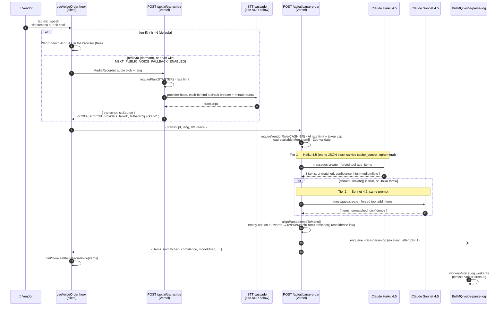
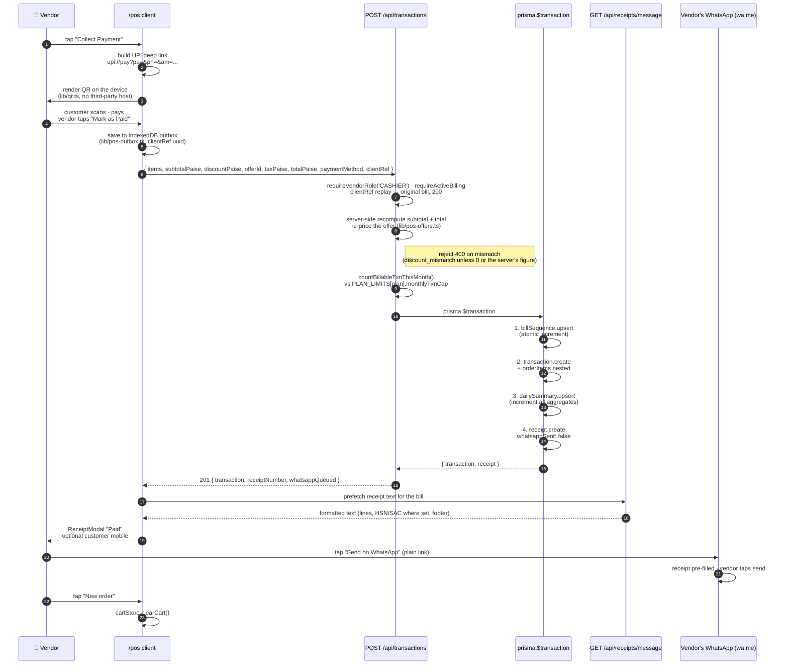
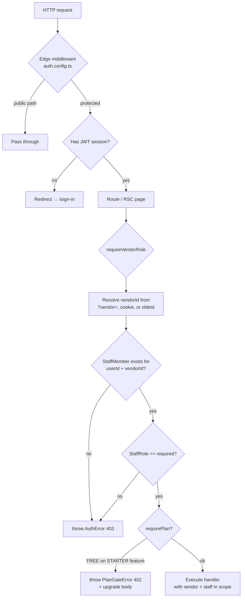
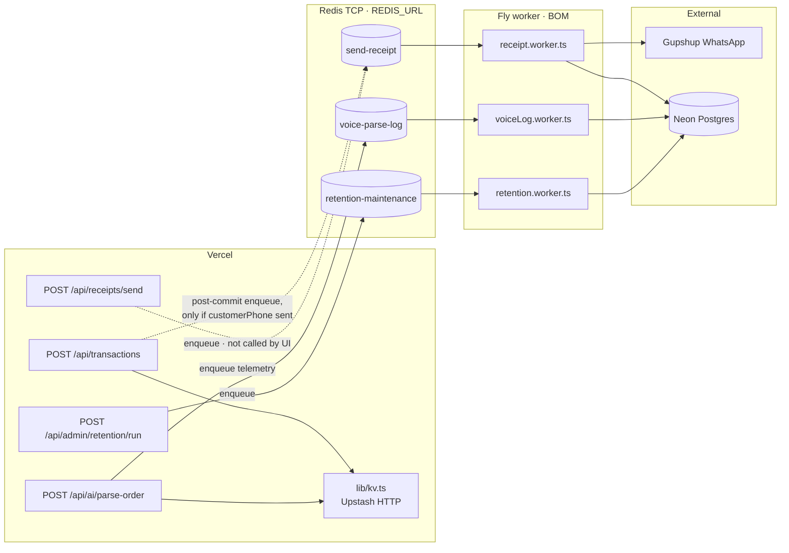
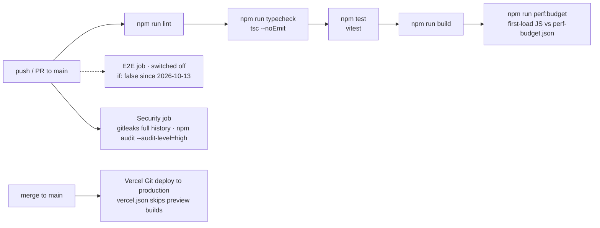
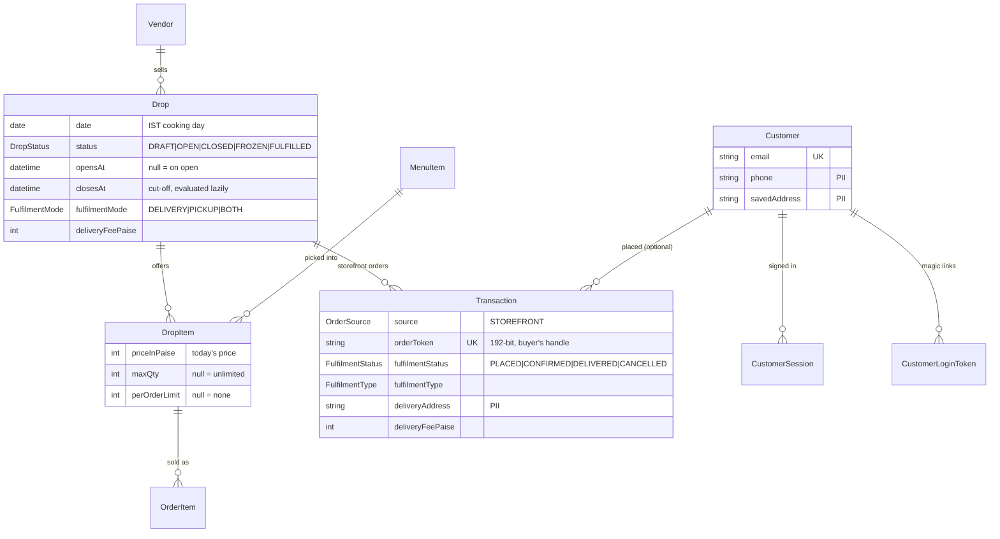
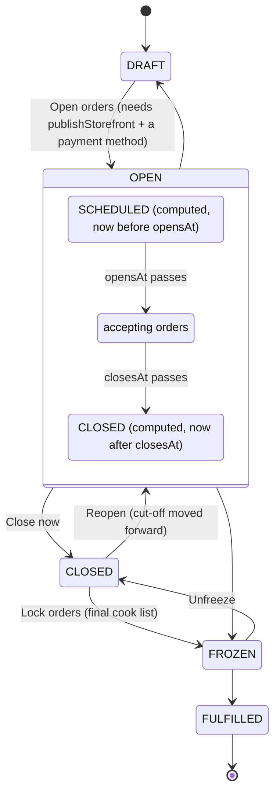

# AwaazOS — Architecture

A working blueprint of the system as it ships today. Read this top-to-bottom before changing the data model, the AI pipeline, or the deploy topology.

---

## 1. System topology

Three providers, one user-facing alias.

```mermaid
flowchart LR
    subgraph User
        Vendor[👤 Vendor on phone<br/>Chrome / WebView<br/>en-IN, IST]
        Customer[👤 Customer<br/>UPI app · WhatsApp]
    end

    subgraph Vercel[Vercel · Edge + Serverless]
        Edge[Edge Middleware<br/>Auth.js v5 · session check]
        Pages[Next.js RSC pages<br/>/marketing /vendor]
        APIs[/api/* route handlers<br/>Node runtime]
        KvHttp[(Upstash REST<br/>UPSTASH_REDIS_*<br/>rate limit · idempotency)]
    end

    subgraph Fly[Fly.io · BOM region]
        Workers[BullMQ Workers<br/>voice-parse-log · send-receipt · retention-maintenance<br/>Node 20 alpine · 512MB]
        Whisper[awaazos-whisper-stt<br/>optional self-hosted ASR<br/>services/whisper-stt]
        Redis[(Redis TCP<br/>REDIS_URL<br/>BullMQ queues)]
    end

    subgraph Neon[Neon Serverless Postgres]
        Pool[(Pgbouncer pooled<br/>DATABASE_URL)]
        Direct[(Direct conn<br/>DIRECT_URL · schema push)]
    end

    subgraph External[External APIs]
        Anthropic[Anthropic<br/>Claude Haiku 4.5 + Sonnet 4.5]
        STT[Cloud STT<br/>Sarvam saaras:v3 · OpenAI gpt-4o-mini-transcribe<br/>Groq whisper-large-v3-turbo]
        Razorpay[Razorpay<br/>platform subscriptions +<br/>vendor-owned storefront keys]
        Gupshup[Gupshup<br/>WhatsApp Business API<br/>wired, not used by the UI]
        AgentMail[AgentMail<br/>password reset + buyer magic links]
        Push[Browser push services<br/>Web Push · VAPID]
    end

    Vendor -->|HTTPS| Edge
    Edge --> Pages
    Edge --> APIs
    Pages --> Pool
    APIs --> Pool
    APIs -->|HTTP| KvHttp
    APIs -->|enqueue TCP| Redis
    APIs -->|tool-use · transcript only| Anthropic
    APIs -->|audio blob| STT
    APIs -->|audio blob · last resort| Whisper
    APIs -->|subs · storefront orders| Razorpay
    Razorpay -->|webhook · HMAC| APIs
    APIs -->|email| AgentMail
    APIs -->|new-order alert| Push
    Workers --> Redis
    Workers --> Pool
    Workers -.->|send-receipt jobs only| Gupshup
    Vendor -->|wa.me link · vendor taps send| Customer
    Customer -->|UPI scan| Vendor
```

POS receipts go out through a `wa.me` link: the vendor's own WhatsApp opens with the receipt text pre-filled (`GET /api/receipts/message`) and the vendor taps send. No Business API, Redis or worker is involved, and it works on every plan. The Gupshup path (`POST /api/receipts/send`, the post-sale enqueue in `POST /api/transactions` when a `customerPhone` is sent, and `workers/receipt.worker.ts`) is still in the code, but the POS UI no longer calls it. Workers never call Anthropic; the only Claude callers are the three draft-building routes `/api/ai/parse-order`, `/api/ai/parse-drop` and `/api/ai/parse-menu` (§3).

### Why this split

- **Vercel** handles the user-facing surface — Next.js RSC, edge middleware (10ms cold start), serverless API routes for short-lived work
- **Fly.io BOM** handles long-running BullMQ workers (Vercel functions are a poor fit for long-lived TCP + retry-heavy job consumers)
- **Neon** is serverless Postgres — branchable, scales to zero, single-region today (us-east-1) to keep latency low for Vercel's serverless hop
- **Two Redis surfaces:** **`UPSTASH_REDIS_REST_URL` + `UPSTASH_REDIS_REST_TOKEN`** power `@upstash/redis` on Vercel (sliding-window rate limits, idempotency keys, monthly AI caps, `/api/ready` Redis probe). **`REDIS_URL`** (`rediss://` TCP) is for **BullMQ only** on Fly (and optionally on Vercel if you point at a **public** endpoint — never a Fly `*.internal` hostname).

### Latency budget (typical voice-to-bill flow)

| Step | Median | P95 |
| --- | ---: | ---: |
| Browser → Vercel `/api/ai/transcribe` | 80ms | 200ms |
| Server STT cascade (5s audio; only when the recorder path is used) | 1.2s | 2.5s |
| Vercel → Anthropic Claude Haiku 4.5 | 350ms | 800ms |
| Cart UI update | 16ms | 32ms |
| `POST /api/transactions` `prisma.$transaction` | 90ms | 250ms |
| Post-commit BullMQ enqueue | 8ms | 25ms |
| Vendor sees UPI QR | **~1.8s end-to-end** | ~3.7s |

For en/hi (Web Speech API path, the default), the STT happens locally — total drops to ~600ms median. Treat these figures as rough targets: they were not re-measured when the STT cascade changed.

---

## 2. Data model

Source of truth is `prisma/schema.prisma` (applied with `prisma db push`; there are no migration files). The diagram shows the core POS models with their main fields. Storefront, Drops and buyer models are summarised in the table below it and drawn in [§11](#11-drops-home-kitchen-pre-orders).

```mermaid
erDiagram
    User ||--o{ StaffMember : "is staff at"
    User ||--o{ Account : "has oauth"
    User ||--o{ Session : "has sessions"
    User ||--o{ PasswordResetToken : "reset links"
    User ||--o{ PushSubscription : "opted-in devices"
    Vendor ||--o{ StaffMember : "has staff"
    Vendor ||--o{ MenuItem : "owns"
    Vendor ||--o{ Transaction : "records"
    Vendor ||--o{ Receipt : "issues"
    Vendor ||--o{ DailySummary : "rolls-up"
    Vendor ||--o{ BillSequence : "atomic counter"
    Vendor ||--o{ VoiceParseLog : "telemetry"
    Vendor ||--o{ Drop : "sells"
    Vendor ||--o{ PushSubscription : "alerts to"
    Vendor ||--o{ Offer : "runs"
    Vendor ||--o| VendorSettings : "has"
    Transaction ||--o{ OrderItem : "contains"
    Transaction ||--o| Receipt : "produces"
    Offer ||--o{ Transaction : "discounted (SetNull on delete)"
    MenuItem ||--o{ OrderItem : "snapshotted in"

    User {
        string id PK
        string email UK
        string passwordHash "null for OAuth-only"
        datetime passwordChangedAt "older sessions rejected"
        UserRole role "USER | ADMIN | SUPER_ADMIN"
    }
    PasswordResetToken {
        string id PK
        string userId FK
        string tokenHash UK "SHA-256, raw never stored"
        datetime expiresAt
        datetime usedAt "single-use"
    }
    Vendor {
        string id PK
        string slug UK
        string name
        string ownerName
        string upiId
        string upiName
        StallType stallType
        Plan plan "FREE | STARTER | PRO | ENTERPRISE"
        datetime planExpiresAt "from Razorpay current_end"
        datetime trialEndsAt "set at sign-up; null = grandfathered FREE"
        string gstin "optional, printed on receipts"
        string logoUrl "Vercel Blob"
        string bannerUrl "Vercel Blob, storefront cover"
    }
    StaffMember {
        string id PK
        string userId FK
        string vendorId FK "unique with userId"
        StaffRole role "OWNER | MANAGER | CASHIER"
    }
    VendorSettings {
        string id PK
        string vendorId FK, UK
        string voiceLang "en-IN | hi-IN | te-IN | kn-IN | ta-IN"
        boolean sendWhatsappReceipt
        boolean taxEnabled
        decimal taxPercent "@db.Decimal(5,2)"
        string hsnDefault "schema only, unused"
        string whatsappNumber
        boolean acceptWhatsappOrders "opt-in: buyers see the number"
        boolean showWhatsappOnStore "opt-in: every store visitor sees it"
        string instagramHandle "bare handle, linked on the store"
        string receiptFooter
        ReceiptPaper receiptPaper "MM58 | MM80 | A4"
        boolean autoPrintReceipt
        boolean publishStorefront "default false"
        boolean acceptMenuOrders "default false"
        string razorpaySubId "platform subscription"
    }
    MenuItem {
        string id PK
        string vendorId FK
        string name
        string slug "unique per vendor"
        string_array aliases "voice aliases"
        string_array tags
        string emoji
        string category "free text, default General"
        int priceInPaise "INTEGER · paise only"
        int sortOrder
        boolean isPopular
        boolean isAvailable
        string imageUrl "Vercel Blob"
        string hsnCode "optional HSN/SAC"
    }
    BillSequence {
        string vendorId PK, FK
        date date PK
        int lastSeq "atomic increment"
    }
    Transaction {
        string id PK
        string vendorId FK
        string billNumber "AWZ-YYYYMMDD-NNNN, indexed not unique"
        int subtotalPaise
        int discountPaise "from one Offer, or 0"
        string offerId FK "nullable"
        string offerName "snapshot, survives offer delete"
        int taxPaise
        int totalPaise "subtotal - discount + delivery + tax"
        PaymentMethod paymentMethod "UPI | CASH | CARD | RAZORPAY_LINK"
        PaymentStatus paymentStatus "PENDING | PAID | FAILED | REFUNDED"
        OrderSource source "VOICE | MANUAL | WHATSAPP | STOREFRONT | API"
        string customerPhone "PII"
        string customerName "PII"
        string upiRef "UTR, PII"
        string voiceTranscript
        string dropId FK "storefront only"
        string orderToken UK "storefront only"
        datetime paymentClaimedAt "buyer tapped I've paid"
        datetime paymentRejectedAt "seller tapped Not received"
        string clientRef "POS outbox uuid, unique per vendor"
        datetime createdAt
        datetime paidAt
    }
    OrderItem {
        string id PK
        string transactionId FK
        string menuItemId FK "nullable for off-menu"
        string dropItemId FK "storefront drop orders"
        string name "snapshotted at sale time"
        int priceInPaise
        int qty
        int totalPaise
        int discountPaise "this line's share of the offer"
    }
    Receipt {
        string id PK
        string transactionId FK, UK
        string vendorId FK
        string receiptNumber "same as billNumber, not unique"
        string publicToken UK "192-bit, /r/[token]"
        boolean whatsappSent
        datetime whatsappSentAt
        string deliveredTo "stored for resend"
    }
    DailySummary {
        string vendorId FK "unique with date"
        date date
        int totalRevenuePaise
        int totalTransactions
        int totalItemsSold
        int cashRevenuePaise
        int upiRevenuePaise
    }
    VoiceParseLog {
        string id PK
        string vendorId FK
        string transcript "no PII"
        string lang
        string sttSource "webspeech | sarvam | openai | groq | whisper"
        string modelUsed "claude-haiku-4-5 | claude-sonnet-4-5"
        boolean escalated
        int itemCount
        string confidence "high | medium | low"
        string_array unmatched
        int latencyMs
        datetime createdAt
    }
```



Models not drawn above:

| Model | What it is |
| --- | --- |
| `Drop`, `DropItem` | A home-kitchen pre-order batch and its per-item price / capacity. See §11. |
| `Customer`, `CustomerSession`, `CustomerLoginToken` | Storefront buyers, kept apart from `User` / Auth.js. Passwordless email magic link; tokens and session ids stored as SHA-256 hashes. See §11. |
| `Offer` | A vendor's quantity plan discount ("4+ quiches incl. 1 paneer → 10% off"): eligibility (all items, item ids or a `MenuItem.tags` tag), `minQty`, optional required tag count, `percentBps`, which channels it applies to (menu orders, drops, POS), optional date window. Rules in `lib/offers.ts`. See §11 "Offers". |
| `DemoHandover`, `DemoAuditLog` | Internal demo stores for founder outreach (`lib/demo-store.ts`, `docs/INTERNAL_DEMO_STORES.md`): a demo store is an ordinary `Vendor` with `isDemo = true` owned by one internal account until the prospect claims it with a one-time token (SHA-256 stored). Every create, delete, handover and claim writes an audit row, and the "create" rows double as the 20-per-day limit. Sample orders carry `Transaction.isSample` and never credit `DailySummary`. |
| `SubscriptionEvent` | Idempotency ledger for the platform subscription webhook (unique Razorpay event id). See §5 "Billing access". |
| `PushSubscription` | One row per staff device opted in to Web Push new-order alerts (`lib/push.ts`). A 404/410 from the push service deletes the row; there is no cleanup job. |
| `Account`, `Session`, `VerificationToken` | Standard Auth.js adapter tables. The session strategy is JWT (`lib/auth.ts`). |

Added with demo stores but valid for real orders: `MenuItem.unit` ("₹1,200 / kg"), `Transaction.advancePaidPaise` (the order stays PENDING until the balance is in; never credits `DailySummary`) and `Transaction.fulfilAt` (when the buyer wants a menu order). Only the demo API writes them so far.

`VendorSettings` also carries the storefront fields (`fssaiNumber`, `acceptPayOnDelivery`, `menuFulfilmentMode`, `menuDeliveryFeePaise`, `menuPickupNote`) and the vendor's own encrypted Razorpay keys (`razorpayKeyId`, `razorpayKeySecretEnc`, `razorpayWebhookSecretEnc`), plus `razorpayCustomerId` for the platform subscription.

### Critical invariants

1. **Money is paise.** Every monetary column is `Int` (paise). The codebase has a `lib/currency.ts` rule banning `parseFloat`, `Number()` on price strings, and `toFixed`. The single allowed `toFixed` lives in `lib/upi.ts` for UPI deep-link `am=` parameter (UPI spec requires decimal rupees).
2. **Bill numbers are unique per `(vendorId, date)`.** Generated atomically inside `prisma.$transaction` via `tx.billSequence.upsert({ ..., update: { lastSeq: { increment: 1 } } })`. Two concurrent sales never collide.
3. **`OrderItem.name` and `priceInPaise` are snapshots**, not joins to `MenuItem`. A menu item deletion or price change must NOT mutate historical bills.
4. **`vendorId` scoping is enforced at the application layer**, not the database. Every Prisma `where` clause that touches multi-tenant data must include `vendorId`. Helper `requireVendorRole(minRole, vendorIdOrSlug?, req?)` resolves the active vendor and throws `AuthError(403)` when the user has no membership there or too low a role. A row that belongs to another tenant is looked up with a compound `where` and returns **404**, so existence never leaks.
5. **PII is firewalled.** `Transaction.customerPhone`, `customerName`, `upiRef` (UTR), `deliveryAddress`, `Receipt.deliveredTo` and the `Customer` contact fields exist for re-send, delivery and reconciliation but are NEVER sent to LLM/STT providers, `VoiceParseLog`, Sentry or push payloads, and NEVER logged in plaintext. Only last-4 appears in CSV exports + audit logs.

---

## 3. AI / Voice pipeline

The headline feature. Two-tier escalation, prompt caching, tool-use.



**Escalation rule** (`shouldEscalate()` in `app/api/ai/parse-order/route.ts`). Haiku's answer goes to Sonnet when any of these holds:

- the cart is empty and the transcript has more than 3 words;
- the cart is empty, the transcript has at least 2 words, and nothing was reported unmatched (Haiku gave up silently, e.g. a misheard "less bill" for Lassi);
- confidence is `low` and something was unmatched.

Any Haiku exception also falls through to Sonnet. There is no numeric confidence score and the API returns no `needsConfirmation` field: confidence is the model's own `high | medium | low`. On the client, `useVoiceOrder` derives `needsConfirmation = confidence === "low"`, and the POS shows an amber double-check banner above the cart.

### Why this design

- **Prompt caching on the menu block** — for a vendor with 30 items, the menu JSON is ~2KB. Cached, the per-call cost on Haiku 4.5 drops by ~75%. Cache lifetime is 5 minutes; the cashier's busiest hour stays warm.
- **Tier-1 Haiku handles the common case** — short, in-menu orders. Cheap and fast.
- **Tier-2 Sonnet covers the rest** — long compound orders ("sat samosa, do chai, ek vada pav, pyaaz wala"), code-mixing ("aap ke pas vada pav hai? to teen do na"), off-menu detection. Sonnet costs several times more, so it runs only when `shouldEscalate()` fires or Haiku throws. The real escalation rate is in `VoiceParseLog.escalated`.
- **Tool-use forces structured output** — no JSON parsing fragility. Claude returns an `add_items` tool call with a typed schema; we get `{ items: [{ menuItemId, name, priceInPaise, qty }], unmatched: [], confidence }` directly. Ids and prices are then re-anchored to real menu rows, so the model's numbers are never trusted.
- **Telemetry is async** — `VoiceParseLog` writes via BullMQ on Fly. The cashier never waits.

### Voice drop and menu builders

Two more routes reuse the same shape (forced tool, Haiku → Sonnet, menu block from `stableMenuJson()` with `cache_control`, server post-processing that never trusts the model). Both return a **draft** for a form and save nothing:

| Route | Role | Tool | Output | Escalates to Sonnet when |
| --- | --- | --- | --- | --- |
| `POST /api/ai/parse-drop` (`lib/parse-drop.ts`) | MANAGER | `build_drop` | `DropDraft`: items re-anchored to the menu, IST dates/times resolved on the server, problems as `warnings` | Haiku throws, no items on a >3-word transcript, or ≥ half the items lack a valid menu id |
| `POST /api/ai/parse-menu` (`lib/parse-menu.ts`) | CASHIER | `add_menu_items` | `MenuDraft`: existing dishes matched by name/alias/fuzzy, new dishes otherwise, prices via `rupeesToPaise` | Haiku throws, no items on a >3-word transcript, or most dishes priceless although numbers were spoken |

The menu builder's confirmed rows are saved by `POST /api/menu/bulk` in one `$transaction` (compound `{ id, vendorId }` updates; foreign ids are skipped). Neither route writes `VoiceParseLog`. Golden sets: `tests/golden/parse-drop/`, `tests/golden/parse-menu/`.

### Indic numeral normalization

Vendors say _"ek"_, _"do"_, _"teen"_, _"sat"_ in Hindi; _"okati"_, _"rendu"_, _"moodu"_ in Telugu; _"ondu"_, _"eradu"_ in Kannada. The system prompt (`ORDER_PARSE_SYSTEM` in `lib/anthropic.ts`) carries a numeral table for hi/te/kn/ta, and the tool schema requires `qty` to be an integer ≥ 1. Fractions like _"adha samosa"_ cannot be expressed, so the vendor fixes those lines by tapping.

### ADR: STT and NLU are separate concerns

**Status:** Accepted · **Date:** 2026-06-26

**Context.** Voice billing is two problems: (1) turn audio into text, (2) turn text + menu into a cart. It is tempting to route both through a single LLM because OpenAI exposes models named `gpt-4o-mini-transcribe` and because a general model can “sort of” do both steps. That coupling raises cost, latency, and privacy surface for work that dedicated ASR already solves well.

**Decision.**

| Layer | Job | Technology | Needs LLM? |
| --- | --- | --- | --- |
| **STT** | audio → transcript | Web Speech · Sarvam `saaras:v3` · OpenAI `gpt-4o-mini-transcribe` · Groq `whisper-large-v3-turbo` · self-hosted Whisper (`services/whisper-stt`) | **No** — ASR only |
| **NLU** | transcript + menu → `{ items, unmatched, confidence }` | Claude Haiku 4.5 → Sonnet 4.5 (`add_items` tool-use) | **Yes** — menu matching, qty extraction, alias resolution |

```
mic → STT (ASR) → transcript string → parse-order (LLM) → cart
```

- **Never** send audio to Anthropic. Only `transcript` + `menu` enter the LLM prompt (`security-first.mdc`).
- **Never** use Claude for transcription. Haiku/Sonnet run only in the transcript-to-draft routes (`parse-order`, `parse-drop`, `parse-menu`).
- OpenAI `gpt-4o-mini-transcribe` is an **ASR API**, not the order parser — same slot as Groq Whisper or Sarvam.
- Self-hosted Whisper (`lib/whisper-stt.ts` → `services/whisper-stt`) is an **optional last-resort STT tier** on Fly, gated by `WHISPER_STT_URL`. It does not replace Sarvam for te/kn/ta until golden STT pass rates match (see `tests/golden/stt/README.md`).

**STT cascade (`POST /api/ai/transcribe`, used only on the recorder path):**

| Lang | Order |
| --- | --- |
| `en-IN`, `hi-IN` | OpenAI → Groq → Whisper (self-hosted) |
| `te-IN`, `kn-IN`, `ta-IN` (dormant) | Sarvam → Groq → Whisper (self-hosted) |

Each hop has its own circuit breaker (`lib/circuit-breaker.ts`) and, for the paid APIs, a minute quota (`lib/ai-usage-guard.ts`). A provider whose env is missing is left out of the cascade: OpenAI needs an `sk-` key, Groq a `gsk_` key, and Whisper needs both `WHISPER_STT_URL` and a `WHISPER_STT_SECRET` of at least 16 characters. The route is plan-gated to STARTER. If every hop fails it returns **200** with `{ error: "all_providers_failed", fallback: "quickadd" }` and the POS falls back to the tap grid.

**Which path runs.** The language picker (`VOICE_LANGUAGES` in `lib/constants.ts`) offers only `en-IN` and `hi-IN`, and those use the browser's Web Speech API by default, so in normal use this route is not called at all. It runs for en/hi only when the build-time flag `NEXT_PUBLIC_VOICE_FALLBACK_ENABLED=true` switches the hook to MediaRecorder. If Web Speech is missing in the browser, the hook shows an `stt_unsupported` error rather than falling back to the server. Telugu, Kannada and Tamil are **dormant**: the Sarvam code path and the `te/kn/ta` values in `SUPPORTED_VOICE_LANGS` remain so older `VendorSettings.voiceLang` rows keep working, but no vendor can pick them. There is no Marathi or Bengali support anywhere.

**Consequences.**

- Python + `faster-whisper` can replace or supplement cloud STT without touching the NLU stack.
- New STT backends must pass `tests/golden/stt` (transcript quality) **before** cutover; new parse-order backends must pass `tests/golden/parse-order` (cart quality).
- Product differentiation stays in NLU (Indic numerals, aliases, unmatched detection), not in re-implementing ASR.

---

## 4. POS transaction flow



The receipt link is built by `receiptWhatsappUrl()` (`lib/whatsapp-message.ts`): a blank number opens WhatsApp's chat picker and a 10-digit number gets `+91`. The text is fetched when the modal opens so the button is a plain link (an `await` before `window.open` is popup-blocked on mobile). The transactions drawer has the same **Send / Resend on WhatsApp** button. This path costs nothing, needs no Redis or worker, and is available on every plan.

**Receipt module.** One pure `ReceiptView` per bill (`lib/receipt.ts`, built by `lib/receipt-data.ts` from the `RECEIPT_TX_SELECT` allowlist, so no customer contact fields or UTR) is rendered three ways by one `<ReceiptDocument>` layout: the WhatsApp text above, the staff print page `/receipts/[bill]` (58 mm / 80 mm thermal or A4 via named `@page` rules; `?autoprint=1`, `?embed=1`), and the public customer page `/r/[token]`, keyed on the 192-bit `Receipt.publicToken`. `VendorSettings.autoPrintReceipt` loads the print page in a hidden iframe after a POS sale on desktop. GSTIN, footer, paper width and auto-print are edited in Settings → Receipts.

**Offline counter sales** (`docs/PWA_OFFLINE_PLAN.md`). `/sw.js` caches `/pos` and its chunks and never intercepts `/api/**`, `/s/**` or non-GET requests. Every checkout is saved to the IndexedDB outbox first, then POSTed with its `clientRef`; `@@unique([vendorId, clientRef])` makes replays return the original bill. Queued sales show "Offline #N" and sync on page load, `online` and tab-visible, never on a timer. A `deferred` sale is billed to the IST day of its `clientCreatedAt` (at most 7 days old), keeps the discount it was rung up with, and still syncs if the vendor was locked after it was made.

**Legacy Gupshup path (wired, unused by the UI).** If a caller sends `customerPhone` to `POST /api/transactions` and the plan has `whatsapp: true`, the route enqueues `send-receipt` after commit; `POST /api/receipts/send` does the same on demand. `workers/receipt.worker.ts` then loads the transaction scoped by `vendorId`, returns early if `receipt.whatsappSent` is already true, posts to Gupshup with an 8 s timeout, and marks the receipt sent. The POS no longer sends `customerPhone`, so in practice `whatsappQueued` is `false`.

### Atomicity proof

The `prisma.$transaction` block bundles **bill number generation + transaction insert + order items + daily summary + receipt** into a single Postgres `BEGIN ... COMMIT`. If any step throws, the entire transaction rolls back — no orphaned bill numbers, no half-recorded sales, no DailySummary drift.

Anything after the sale happens **outside the transaction**, after commit. The wa.me receipt is a client-side link, and the legacy Gupshup enqueue logs and swallows its own failures, so Redis being down never blocks a sale.

---

## 5. Auth & RBAC



### Two-layer RBAC

| Layer | Enum | Values | Stored on | Purpose |
| --- | --- | --- | --- | --- |
| Platform | `UserRole` | `USER`, `ADMIN`, `SUPER_ADMIN` | `User.role` | AwaazOS internal admin (us); `/admin/metrics` needs `ADMIN`+; `/admin/vendors` (free access) needs `SUPER_ADMIN` |
| Tenant | `StaffRole` | `OWNER`, `MANAGER`, `CASHIER` | `StaffMember.role` | Per-vendor permissions |

A `User` can be staff at multiple `Vendor`s (multi-org). Active vendor resolution priority: `?vendor=` query param → `awz_vendor` cookie → oldest membership. When `requireVendorRole` returns a non-null `setVendorCookie`, the route sets that cookie on its response.

Storefront buyers (`Customer`) never pass through this flow; they have their own magic-link session (`lib/customer-auth.ts`).

### Plan gating

```typescript
// Throws PlanGateError(402) carrying { required, current } if vendor.plan < required
requirePlan(vendor, Plan.STARTER);

// Route maps it to 402 { error, code: "plan_upgrade_required", requiredPlan, currentPlan, feature }
// so the UI can show an upgrade CTA to /settings/billing
```

Current `requirePlan` call sites, all STARTER: `/api/ai/transcribe`, `/api/receipts/send`, `/api/transactions/export` (CSV; a locked vendor may still export) and saving the vendor's own Razorpay keys (`PUT /api/vendor/payments`). Trial vendors pass every STARTER gate.

`PLAN_LIMITS` table lives in `lib/constants.ts`:

| Plan | Price/mo | monthlyTxnCap | maxStaff | whatsapp | razorpayLinks | sarvamStt | analyticsDays | csvExport |
| --- | ---: | ---: | ---: | --- | --- | --- | ---: | --- |
| FREE | ₹0 | 50 | 1 | ❌ | ❌ | ❌ | 7 | ❌ |
| STARTER | ₹299 (₹2,990/yr) | null (∞) | 3 | ✅ | ✅ | ✅ | 90 | ✅ |
| PRO | ₹799 | null (∞) | null | ✅ | ✅ | ✅ | 365 | ✅ |
| ENTERPRISE | custom | null | null | ✅ | ✅ | ✅ | 365 | ✅ |

Prices exclude 18% GST (`GST_BPS`); the Razorpay plan amount is base + GST (`subscriptionChargePaise`). `txnPerMonth` and `whatsappReceipts` duplicate `monthlyTxnCap` and `whatsapp`. `whatsapp` gates only the dormant automated Gupshup send — wa.me receipts from the vendor's own WhatsApp work on every plan. `razorpayLinks` gates the vendor's own Razorpay keys for storefront payments. `maxStaff` is not read anywhere (there is no staff invite flow). Marketing copy is derived from this table in `lib/plan-copy.ts`, and only STARTER is marketed (`MARKETED_PLANS`); FREE survives only for vendors who signed up before the trial, and PRO and ENTERPRISE stay in the code for the gates.

### Billing access (trial, lock, paid)

Full design in `docs/RAZORPAY_SUBSCRIPTIONS_PLAN.md`. `billingAccess(vendor)` (`lib/plan.ts`) derives one of four states on every read; nothing is written when a date passes, so Neon can sleep.

| State | When | Effect |
| --- | --- | --- |
| `paid` | paid plan, not past `planExpiresAt` + 3-day grace | that plan's limits |
| `trial` | not paid, before `trialEndsAt` (sign-up + `TRIAL_DAYS`, 30) | STARTER limits |
| `locked` | not paid, `trialEndsAt` passed | no new sales, storefront orders or AI calls |
| `free` | not paid, `trialEndsAt` null (signed up before the trial) | FREE limits, never locked |

`requireVendorRole` returns `access` and the effective plan. Routes that make a new sale, take a new order or spend on AI call `requireActiveBilling(ctx)` → 402 `{ error: "billing_locked" }`; reads, settings, billing, CSV export and finishing existing orders never do. Buyers of a locked vendor get `orders_paused` (409) at checkout.

Subscribing happens in place on the billing page with Razorpay Checkout → `POST /api/razorpay/verify-subscription` (HMAC check, subscription must be the vendor's own). The verify route and the webhook (`/api/webhooks/razorpay`, idempotent through `SubscriptionEvent`) both write through `recordSubscriptionEvent` (`lib/subscription-store.ts`); `planExpiresAt` only moves forward and the webhook never downgrades a paying vendor.

**Free access by hand.** A platform SUPER_ADMIN can pick a "free until" day for a store on `/admin/vendors` (`PATCH /api/admin/vendors/[id]/free-access`, `lib/admin-free-access.ts`). It moves only `trialEndsAt` (23:59 IST that day, up to 24 months out); `plan` and `planExpiresAt` are untouched. Anyone else gets 404.

---

## 6. Background jobs

BullMQ queues run on **Redis TCP** (`REDIS_URL`) consumed by **Fly.io** workers (`workers/index.ts`). Vercel uses **Upstash REST** (`lib/kv.ts`) for rate limiting, idempotency, circuit breakers, AI usage caps and the drops-board signal counter — not the same transport as BullMQ.



Dotted edges are the legacy Gupshup receipt path, which stays wired but which the POS UI no longer triggers (receipts go out via `wa.me`, see §4). Nothing in this diagram runs on a timer: retention runs only when an admin calls `POST /api/admin/retention/run`.

### Worker contracts

Payload types live in `lib/queues.ts`. `DEFAULT_JOB_OPTS` there is 5 attempts with exponential backoff from 5 s, failed jobs kept 7 days; enqueue sites override it where noted.

| Queue | Job payload | Idempotency | Retry policy |
| --- | --- | --- | --- |
| `send-receipt` | `{ transactionId, vendorId, customerPhone }` | early-return if `Receipt.whatsappSent === true` | 3 attempts, exponential from 5 s (both enqueue sites) |
| `voice-parse-log` | `{ vendorId, transcript, lang, sttSource, modelUsed, latencyMs, itemCount, confidence, unmatched, escalated }` | n/a (write-only telemetry) | 1 attempt, no retry |
| `retention-maintenance` | `{ requestedBy: "admin", requestedByUserId? }` | jobId `retention:<UTC day>` dedupes a day's runs | `DEFAULT_JOB_OPTS` |

The retention worker deletes `VoiceParseLog` rows older than 90 days and receipts older than 7 years.

### Web Push (not a queue)

New-order alerts for storefront and menu orders go straight from the API route to the browser push services via `web-push` (`lib/push.ts`). `notifyVendorInBackground()` hands the send to Vercel's `waitUntil`, so it never blocks the response and needs no worker. It is feature-gated on the VAPID env, sends to the vendor's active staff who opted in on a device, and carries no buyer PII (bill number, amount and item count only).

`public/sw.js` also posts each push to open pages. `OrderVoiceAlerts` (`lib/order-voice.ts`) then says "New order received from <first name>" with an on-device voice when Sound is on for that device (on by default), reading the first name from `GET /api/storefront-orders/announce` rather than from the payload, and tells an open orders board to refetch at once. Listener only, no timer.

---

## 7. Money math discipline

The hardest-won invariant in the codebase. Banned constructs and their replacements:

| Banned | Use instead | Why |
| --- | --- | --- |
| `parseFloat(price)` | `parseInt(rupees) * 100 + parseInt(paise)` | float precision loss compounds; ₹19.99 + ₹19.99 ≠ ₹39.98 |
| `priceInPaise / 100` | `paiseToRupees(priceInPaise)` (returns string for display only) | display-only conversion |
| `Number(price.toFixed(2))` | integer paise everywhere internally | round-trip through float = drift |
| `Math.round(x * 0.18)` for tax | `Math.floor(subtotalPaise * taxBps / 10000)` where `taxBps = Math.round(taxPercent * 100)` | bps integer math is reproducible across servers |
| `${rupees}.${paise}` template | `formatINR(paise)` | uses `Intl.NumberFormat('en-IN', { style: 'currency', currency: 'INR' })` for ₹1,23,456 grouping |

### The one allowed exception

```typescript
// lib/upi.ts — UPI spec REQUIRES decimal rupees in the deep-link
const amountRupees = (totalPaise / 100).toFixed(2); // UPI spec exception — see .cursor/rules/money.mdc
return `upi://pay?pa=${pa}&pn=${pn}&am=${amountRupees}&cu=INR&tn=${tn}`;
```

This is **the only `toFixed` in the entire codebase**. CI grep guard recommended:

```bash
rg -l "toFixed" --glob '!lib/upi.ts' --glob '!*.md' app/ components/ lib/ workers/ hooks/
# → must return 0 files
```

---

## 8. Quality gates

Locally, the husky pre-commit hook runs `npm run precommit:checks` (lint-staged) and `gitleaks protect --staged` when gitleaks is installed. CI (`.github/workflows/ci.yml`) runs on every push and pull request to `main`:



The Playwright job is still defined (Postgres 15 service, `prisma db push`, chromium) but disabled, so E2E runs locally against a throwaway Postgres before a merge (recipe in `CLAUDE.md`). Test counts drift with every change, so they are not recorded here; `npx vitest run` and `npx playwright test --list` print the current numbers. Live golden runs (`GOLDEN_*_LIVE=1`) cost money and are not part of CI. Never run the E2E suite against the production database: it creates vendors and sales.

---

## 9. Trade-offs we made

- **Neon over Supabase** — chose Neon for branchable databases + serverless-first pricing. We lose Supabase's bundled storage / auth / realtime, but we gain simpler bill-of-materials (one provider per concern) and full Auth.js v5 freedom. Storage moved to Vercel Blob.
- **Auth.js v5 over Clerk** — Clerk is faster to integrate but expensive at scale (~$25/mo per 1000 MAU after 10K) and has India-specific friction (no native +91 OTP without Twilio Verify integration cost). Auth.js + Prisma adapter is free and gives us full control of the User schema for multi-tenant `StaffMember` joins.
- **Two-tier Claude over single Sonnet** — saves ~70% on inference cost for what is essentially the per-transaction unit cost of the product. Justifies the added escalation logic complexity.
- **Self-hosted BullMQ over Vercel Cron** — Cron is fine for scheduled work; for retry-with-backoff on a per-job basis (what Business-API WhatsApp delivery needed), BullMQ wins. POS receipts have since moved to `wa.me` links, so today the queues carry voice telemetry, admin-triggered retention, and the unused Gupshup path. Cost: one Fly machine ($0/mo on shared-cpu-1x free tier as of 2026) + Upstash Redis ($0 baseline + $0.20 per 100K commands).
- **Server-side recompute of totals** — we throw 400 if `subtotalPaise + taxPaise - discountPaise !== totalPaise` from the client. Costs nothing, prevents an entire class of "client tampered with cart" bugs.
- **Snapshotted `OrderItem.name` and `priceInPaise`** — denormalized, but historical bills don't break when a vendor renames or deletes a menu item.
- **Minimal GST support** — most home kitchens and micro-merchants don't have a GSTIN. What has shipped: an optional `Vendor.gstin` (format-checked, Settings → Receipts) printed on every receipt, an optional HSN/SAC code per menu item (`MenuItem.hsnCode`) printed on the WhatsApp receipt text, and one flat tax rate (`taxEnabled` + `taxPercent`, applied in basis points). `VendorSettings.hsnDefault` exists in the schema but nothing reads it. Not built: a CGST/SGST/IGST split or GST-formatted invoices.
- **Offline counter sales only** — the POS works offline through the IndexedDB outbox (§4); the storefront, orders board and every other screen need a connection.
- **One offer per order, percent only** — the largest discount wins and offers never stack (`lib/offers.ts`). No coupon codes, per-customer limits, fixed-amount or bundle prices; it covers "weekly plan" pricing without a promotions engine.

---

## 10. What we're NOT building

To stay focused, AwaazOS is explicitly **not**:

- A delivery aggregator (no rider network, no Zomato-style discovery)
- An inventory ERP (we'll do simple deduct, not multi-warehouse)
- A loyalty / CRM platform (out of scope until 10K vendors)
- An accounting / tax filing tool (we'll integrate; not build)
- A general-purpose SaaS (we will not pivot to "POS for restaurants in the US")

If a feature isn't on the path to "an Instagram cloud kitchen takes, gets paid for and delivers a batch of orders with less DM work" (`docs/ICP.md`), it's a no. The voice counter POS is maintained but no longer the first filter.

---

## 11. Drops (home-kitchen pre-orders)

A **Drop** is one batch of cooking a home kitchen sells ahead of time: "Saturday bakes — order by Fri 9 pm, delivery Sat 5–8 pm". The vendor builds it from her existing menu, shares `/s/<slug>`, buyers order against capped stock, and on the day she gets a cook list and a delivery list. Core rules: `lib/drops.ts` (read its header). Vendor UI: `/drops`, `/orders` (the one orders board: drop and menu orders together; `/drops/[id]` redirects to `/orders?drop=<id>`), `/drops/[id]/edit`, `/drops/[id]/prep`. Buyer UI: `/s/[slug]`, `/s/[slug]/o/[token]`, `/s/[slug]/account`.

### Data model



- `MenuItem` stays the master catalogue; `DropItem` is today's price + capacity. `OrderItem.dropItemId` links a sold line back to its drop item; `name`/`priceInPaise` are still snapshots.
- Storefront orders are ordinary `Transaction` rows (`source = STOREFRONT`), so revenue, bill numbers (`AWZ-YYYYMMDD-NNNN`), receipts and exports work unchanged. The storefront-only columns are null for counter sales.
- **There is no sold-count column.** Sold = sum of `OrderItem.qty` over orders that currently hold stock (`stockHoldingOrderWhere`): paid, pay-on-delivery, UTR submitted, confirmed/delivered, or placed less than `PENDING_HOLD_MINUTES` (15) ago. Cancelled never holds.
- `Customer`, `CustomerSession`, `CustomerLoginToken` are buyers, deliberately separate from `User`/NextAuth. Tokens and session ids are stored as SHA-256 hashes only.
- `VendorSettings` gains `fssaiNumber`, `acceptPayOnDelivery` (default `true`), and the vendor's own `razorpayKeyId` / `razorpayKeySecretEnc` / `razorpayWebhookSecretEnc`.

### Lifecycle



Only the vendor moves the **stored** status (`ALLOWED_TRANSITIONS` in `lib/drops.ts`). Time-based states are computed on every read by `effectiveDropStatus()` and never written: a stored-OPEN drop shows as SCHEDULED before `opensAt` and as CLOSED after `closesAt`. Transitions are checked against the *effective* status, so an OPEN drop past its cut-off can be frozen directly. FROZEN locks confirm/cancel; payment and handover actions still work.

### Order flow

```mermaid
sequenceDiagram
    participant B as Buyer (browser)
    participant S as /s/[slug] (RSC)
    participant API as POST /api/s/[slug]/orders
    participant DB as Postgres (Neon)
    participant KV as Upstash
    participant V as Vendor board /orders

    B->>S: open storefront
    S->>DB: vendor (publish-gated, allowlisted select) + OPEN drops + sold counts
    S-->>B: drops with "Only N left"
    B->>API: items, name, phone, fulfilment, payment method (Idempotency-Key)
    API->>API: IP rate limit, Zod, publish gate (404)
    API->>DB: BEGIN; SELECT drop FOR UPDATE
    API->>DB: effective status, fulfilment, per-order limit, stock, plan cap
    API->>API: applyOffers() — the server prices the order
    API->>DB: billSequence.upsert, transaction + orderItems + receipt
    API->>DB: COMMIT
    API--)KV: bump orders:{vendorId} (fire-and-forget)
    API-->>B: 201 { orderToken }, redirect to /s/[slug]/o/[token]
    V->>KV: GET /api/storefront-orders/signal every 6 min (visible + accepting only; Web Push is the instant path)
    V->>DB: refetch orders only when the counter moved
```

Rejections are typed (`PlaceOrderError`): `sold_out` carries `remaining` so the buyer's cart is trimmed in place; `drop_not_open` covers a cut-off that passed while the buyer was filling the form.

The buyer's order page has no timer either: it refreshes when the tab becomes visible again, on `pageshow`, and from a "Check for update" button. The buyer's device remembers recent orders in localStorage (`components/storefront/recent-orders.ts`: token, bill number and date, no PII).

### Payment paths

| Path | How it gets paid | Who marks it paid |
| --- | --- | --- |
| **UPI intent + "I've paid"** | Order page shows the vendor's UPI QR / `upi://` link for the exact amount; buyer pays in any app and taps **I've paid** (`paymentClaimedAt`; UTR optional) | Vendor checks her UPI app and taps **Payment received**, or **Not received** (clears the claim, stamps `paymentRejectedAt`; the next claim then needs a UTR). Nothing is auto-verified, and a claim never marks an order paid. |
| **Pay on delivery** | Cash or UPI at the door / pickup (`acceptPayOnDelivery`) | Vendor's **Delivered · ₹X collected** tap marks it paid in the same DB transaction |
| **Vendor's Razorpay** | Razorpay Checkout using the **vendor's own** keys; order created on her account | Signature verify on return (`/razorpay/verify`) or her webhook `/api/webhooks/razorpay-orders/[vendorId]`, whichever lands first |

All three converge on `markOrderPaid()`: a conditional `updateMany` (`paymentStatus != PAID`, not cancelled) is the idempotency guard, and `DailySummary` is credited exactly once, **on payment, not placement**. `cancelOrder()` on a paid order sets `REFUNDED` and reverses the credit on the day it was made; the refund itself happens out of band. Storefront orders count toward `monthlyTxnCap` only once paid.

### Order from menu (no Drop)

A vendor who turns on `VendorSettings.acceptMenuOrders` lets buyers order everyday `MenuItem`s on `/s/[slug]` at any time (`lib/menu-orders.ts`, `POST /api/s/[slug]/menu-orders`). These are the same `STOREFRONT` transactions with `dropId = null`, the same three payment paths and the same plan-cap rule. Differences from a Drop: no cut-off and no stock caps (so no row lock), only `isAvailable` items can be ordered, prices are always re-read from `MenuItem`, and fulfilment mode, delivery fee and pickup note come from `menuFulfilmentMode` / `menuDeliveryFeePaise` / `menuPickupNote`. The vendor works them from `/orders`, which polls `/api/storefront-orders/signal` every 6 minutes. That interval is deliberately longer than Neon's idle timeout, because each tick still reads Postgres through `requireVendorRole`.

Both kinds of storefront order fire a Web Push alert to opted-in staff devices when placed, and again when a buyer submits a payment claim (§6).

### One orders board

`/orders` lists every storefront order, menu orders and all drops' orders, in one list (`loadOrdersBoard` in `lib/drops-board-server.ts`: the last 3 IST days, older orders still open, and every order of a drop whose handover window ended in those 3 days). A "Show orders from" picker narrows it to menu orders or one drop; `/orders?drop=<id>` opens it on a drop. Actions still go to each order's own route family (`orderActionBase`), so each keeps its compound scope. The board selects orders for bulk confirm / mark paid / deliver (one transaction per order, so one stale order never rolls back the rest), searches, filters by pickup or delivery, collapses handled orders, offers Undo after handover, and asks for confirmation before marking an order paid that has no buyer claim.

### Offers

An `Offer` is a vendor's quantity plan ("4+ quiches incl. 1 paneer → 10% off"), edited in Settings → Offers (`/api/offers`, MANAGER). All rules are in `lib/offers.ts` (pure, client-safe):

- **Eligibility:** all items, chosen item ids, or a `MenuItem.tags` tag (trimmed, case-insensitive). The optional "at least N of tag X" counts eligible lines only.
- **One offer per order.** The largest discount wins; ties go to the higher `minQty`, then the older offer. Delivery fees are never discounted.
- **Rounding:** `floor(eligibleSubtotal × bps / 10 000)`, split across eligible lines by largest remainder into `OrderItem.discountPaise`.
- **No timers:** `startsAt` / `endsAt` are compared on every read.
- **The server prices.** `placeStorefrontOrder` and `placeMenuOrder` call `applyOffers` inside their transaction (buyers send ids and quantities only), so the Razorpay amount, UPI QR and `DailySummary` all use the server's total. The POS prices its own cart because it works offline; `POST /api/transactions` re-prices it (`lib/pos-offers.ts`).
- Public pages receive resolved offers only (name, description, numbers, item ids on that page); raw tags stay on the server. `Transaction.offerName` is a snapshot, labelled on receipts, boards and the CSV by `discountLabel()`.

### Settings hub

`/settings` is a hub with one-line status per area (pure helpers in `lib/settings-overview.ts`). Sub-pages: `store` (Online store: name, banner and logo, publish, Instagram handle, FSSAI), `orders` (Online orders: order from menu, WhatsApp orders and the store-page WhatsApp link), `payments` (UPI, pay on delivery, vendor Razorpay keys), `offers`, `receipts` (GSTIN, footer, paper width, auto-print), `voice`, `notifications` (Web Push devices, Sound) and `billing`. The setup checklist and the trial/lock notice are shown where the seller lands (`/orders`, `/drops`, and collapsed on `/pos`), trimmed to the viewer's role.

### ADR: vendor-owned Razorpay keys vs platform collection

**Status:** Accepted · **Date:** 2026-10-05

**Context.** Buyers want to pay online at order time. The simplest build is to collect through AwaazOS's own Razorpay account (already used for subscriptions) and pay vendors out. That makes AwaazOS hold and settle third-party money, which under RBI's payment-aggregator guidelines requires PA authorisation, net-worth thresholds and escrow — out of reach and out of scope.

**Decision.** Online storefront payments go through the **vendor's own Razorpay account**. She pastes her key id, key secret and webhook secret in Settings; secrets are AES-256-GCM encrypted with `PAYMENT_KEYS_ENCRYPTION_KEY` (`lib/secret-box.ts`) and never logged or returned. `lib/storefront-razorpay.ts` calls the Razorpay API with plain `fetch` per vendor (the SDK is a single-account singleton). Platform `RAZORPAY_*` keys and `lib/razorpay.ts` remain for AwaazOS's own billing only. Each vendor's webhook has its own URL, so the path selects which secret to verify against.

**Consequences.**

- Money settles straight to the vendor; AwaazOS never touches it, so no PA licence and no payout reconciliation.
- Onboarding friction: a vendor needs a Razorpay account (KYC). UPI intent + UTR and pay on delivery stay first-class so the feature works without one.
- The order webhook cannot verify HMAC before *any* DB read — it must load that vendor's encrypted secret first. It reads only that column, and unknown vendor / bad signature both return 400.
- Losing `PAYMENT_KEYS_ENCRYPTION_KEY` means every vendor re-enters keys; rotating it needs a re-encrypt pass.

### ADR: lazy cut-off vs scheduled job

**Status:** Accepted · **Date:** 2026-10-05

**Context.** Drops have an order cut-off, and unpaid UPI orders have a 15-minute stock hold. The conventional build is a cron/BullMQ job that flips OPEN → CLOSED and expires holds. Neon (like every metered backend here) scales to zero; any job running more often than the idle timeout pins it awake and bills as if saturated.

**Decision.** No timers. The cut-off is a pure function of `(status, opensAt, closesAt, now)` — `effectiveDropStatus()` — evaluated on every read and inside the order transaction. Holds are a `createdAt` window in the sold-count query, not a row that expires. The stored status changes only when the vendor acts.

**Consequences.**

- Zero background Postgres traffic between orders; correctness doesn't depend on a worker being up.
- Every reader must go through `effectiveDropStatus()` / `isAcceptingOrders()`; comparing `drop.status === "OPEN"` directly is a bug.
- A drop's stored status can say OPEN long after it closed. Queries that need "really open" filter on stored OPEN and then evaluate in code (the storefront also hides closed drops after a 12 h grace).
- The orders board, which does want freshness, polls an Upstash counter rather than Postgres (`lib/drops-signal.ts`).
